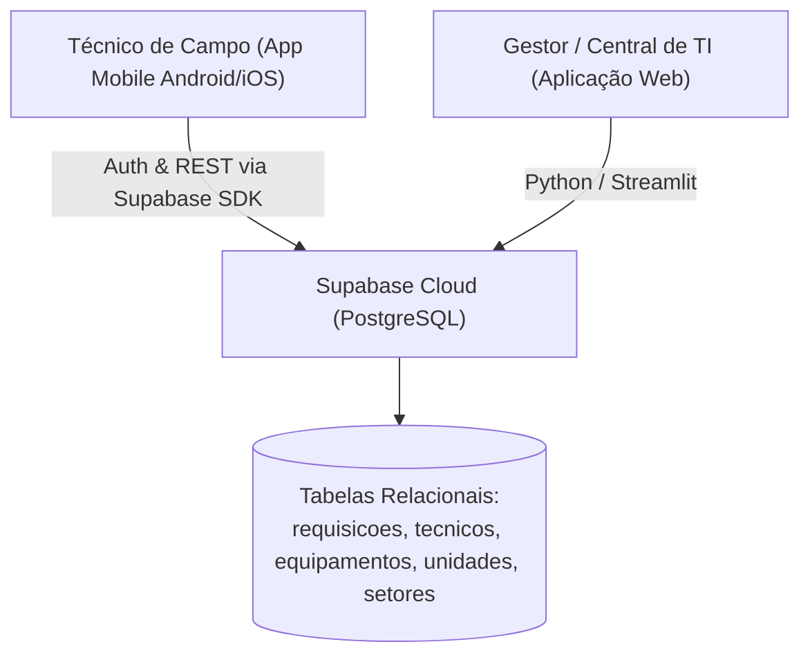

# 📘 Relatório Técnico e Documentação da Aplicação Mobile: Gestão TagsInfor

Este documento consolida todas as especificações técnicas, arquitetura de software, stack de tecnologias, regras de negócio e módulos implantados no aplicativo móvel **Gestão TagsInfor**.

---

## 1. Visão Geral do Sistema

O aplicativo móvel **Gestão TagsInfor** foi concebido para atender às demandas de campo dos técnicos de suporte de TI e das equipes de manutenção em unidades públicas e privadas de saúde (USF Porte I e Porte IV). A solução funciona de forma totalmente integrada e sincronizada em tempo real com a aplicação web (Streamlit) através do banco de dados relacional em nuvem **Supabase (PostgreSQL)**.



---

## 2. Tecnologias e Linguagens Utilizadas

| Camada / Componente | Tecnologia | Versão / Detalhes | Finalidade |
| :--- | :--- | :--- | :--- |
| **Linguagem Principal** | **Dart** | `^3.5.0` | Linguagem fortemente tipada, compilada AOT (*Ahead-Of-Time*) para código nativo Android e iOS. |
| **Framework Mobile** | **Flutter** | `3.24+ / 3.47+` | Framework reativo multiplataforma para construção de interfaces fluidas em 60/120 FPS. |
| **Design System** | **Material Design 3** | Material 3 Specification | Paleta institucional (*Deep Slate, Cyan Neon, Teal, Emerald Green*), tipografia **Inter** do Google Fonts. |
| **Backend as a Service** | **Supabase** | `supabase_flutter: ^2.8.0` | Autenticação corporativa (JWT), banco de dados PostgreSQL e consultas relacionais via PostgREST. |
| **Captura de Câmera** | **Mobile Scanner** | `mobile_scanner: ^7.4.2` | Reconhecimento óptico de códigos de barras (Code128, EAN) e QR Codes em etiquetas de patrimônio. |
| **Assinatura Biométrica** | **Signature** | `signature: ^6.4.0` | Canvas vetorial com renderização para PNG/Base64 para validação de entrega de equipamentos. |
| **Ícones do Sistema** | **Cupertino & Material** | Standard Vector Icons | Ícones corporativos nativos adaptados para Android e iOS. |

---

## 3. Arquitetura do Código-Fonte (`mobile/lib/`)

A aplicação adota o padrão de separação de responsabilidades em camadas desacopladas:

```text
mobile/
├── lib/
│   ├── core/
│   │   ├── config.dart         # Credenciais seguras e endpoints do Supabase
│   │   ├── constants.dart      # Listas de domínio, tipos de visita, status e mapeamentos
│   │   └── theme.dart          # Design system Material 3, paleta de cores e tipografia
│   ├── models/
│   │   ├── auxiliares_model.dart # Modelos de dados: Unidade, Setor, Técnico e Equipamento
│   │   └── chamado_model.dart    # Modelo relacional da Ordem de Serviço com parsing defensivo
│   ├── services/
│   │   └── supabase_service.dart # Camada de acesso a dados (CRUD, Auth, Fallbacks multinível)
│   ├── screens/
│   │   ├── login_screen.dart          # Tela de autenticação institucional com logo TagsInfor
│   │   ├── home_screen.dart           # Painel de O.S. com filtro "Minhas O.S." e busca
│   │   ├── chamado_detail_screen.dart # Atendimento de O.S. com regras de permissão
│   │   ├── novo_chamado_screen.dart   # Cadastro de chamado com filtros em cascata e bloqueio de técnico
│   │   ├── scanner_screen.dart        # Leitor de código de barras e patrimônio via câmera
│   │   ├── assinatura_screen.dart     # Coleta de assinatura digital na tela com validação
│   │   └── dashboard_screen.dart      # Painel de métricas contratuais de SLA e indicadores operacionais
│   └── main.dart               # Ponto de entrada do app com inicialização assíncrona
```

---

## 4. Módulos e Funcionalidades Implantadas

### 4.1. Autenticação e Gestão de Sessão (`login_screen.dart`)
- Login direto com credenciais corporativas armazenadas no **Supabase Auth**.
- Identificação automática do perfil do usuário:
  - Detecção de administradores via padrão de e-mail (`admin@...`).
  - Vinculação do e-mail ao registro oficial do técnico na tabela `tecnicos`.
- Persistência segura de sessão criptografada no dispositivo.

### 4.2. Painel de Ordens de Serviço (`home_screen.dart`)
- **Seletor de Escopo de Atendimento**:
  - `[ 🌐 Todas as O.S. (Total) ]`: Visão ampla de toda a fila de chamados do contrato.
  - `[ 👤 Minhas O.S. (Qtd) ]`: Filtro dinâmico com 1 toque que isola apenas os chamados do técnico logado.
- **Pílulas de Ciclo de Vida**: Filtros por status (*Todos, Pendentes, Em Manutenção, Estoque, Concluídos*).
- **Busca em Tempo Real**: Filtro instantâneo por ticket, unidade de saúde, equipamento, setor, número de pedido no estoque ou nome do técnico.
- **Formatação Amigável**: Exibição da data de atendimento no padrão brasileiro (`DD/MM/AAAA HH:mm`).

### 4.3. Atendimento e Governança de O.S. (`chamado_detail_screen.dart`)
Matriz de permissões estritas para evitar alterações indevidas em prazos contratuais:

| Campo na Ordem de Serviço | Técnico de Campo | Administrador de TI | Comportamento Técnico |
| :--- | :---: | :---: | :--- |
| **Status Operacional** | ✅ Permitido | ✅ Permitido | Dropdown de ciclo de vida com atualização imediata no banco. |
| **Serviço Realizado** | ✅ Permitido | ✅ Permitido | Campo de texto livre + chips de seleção rápida em 1 toque. |
| **Observações / Parecer Técnico** | ✅ Permitido | ✅ Permitido | Campo multilinha para detalhamento técnico do reparo. |
| **Nº Pedido Estoque** | ❌ **Bloqueado** | ✅ Permitido | Somente leitura para técnicos (ícone de cadeado cinza). |
| **Data Prevista de Retorno (SLA)**| ❌ **Bloqueado** | ✅ Permitido | Somente leitura para técnicos (ícone de cadeado cinza). |

> [!IMPORTANT]
> A camada de serviço ([supabase_service.dart](file:///c:/Users/USUARIO/Documents/Pasta%20casa/gestao-equipamentos/mobile/lib/services/supabase_service.dart)) valida o papel do usuário no envio do pacote. Caso o usuário não seja administrador, os campos de Pedido e Data Prevista são omitidos do payload de atualização, garantindo segurança a nível de dados.

### 4.4. Abertura de Novas Requisições (`novo_chamado_screen.dart`)
- **Indicação Visual de Obrigatoriedade**: Todos os campos essenciais possuem asterisco vermelho (`*`).
- **Filtro em Cascata por Porte**: Ao selecionar entre *PORTE I* ou *PORTE IV*, a lista de unidades e setores é recalculada automaticamente.
- **Trava de Técnico**: Para técnicos não administradores, o campo *Técnico Responsável* é pré-selecionado com o seu nome e bloqueado contra alteração, impedindo a atribuição inadvertida para outro profissional.
- **Leitura via Câmera**: Botão integrado de scanner que preenche o ticket ou código de patrimônio automaticamente.

### 4.5. Leitor de Patrimônio e Código de Barras (`scanner_screen.dart`)
- Utiliza a câmera traseira com taxa de atualização de 60 quadros por segundo.
- Suporte a iluminação assistida (toggle de lanterna/flash).
- Caixa delimitadora com guia visual animada.
- Fallback para inserção manual caso a etiqueta esteja rasurada ou ilegível.

### 4.6. Coleta de Assinatura Digital na Tela (`assinatura_screen.dart`)
- Área de captura com suporte a gestos de toque (caneta stylus ou dedo).
- Exportação em tempo real para imagem PNG de alta definição em formato Base64.
- Gravação imediata vinculada ao registro da unidade e do atendimento para validade jurídica e auditorias.

### 4.7. Dashboard Executivo de SLA e Métricas (`dashboard_screen.dart`)
- **Banner de Conformidade de SLA**: Notificação verde quando 100% das ordens estão dentro do prazo, ou alerta vermelho destacando chamados com atraso superior a 48h.
- **6 Indicadores Chave de Desempenho (KPIs)**:
  1. *Total de O.S.*
  2. *Taxa de Resolução Global (%)*
  3. *Pendentes / Aguardando Peças*
  4. *Em Manutenção Técnica*
  5. *Pedidos no Estoque*
  6. *Postos Assistidos (Unidades de Saúde com chamado)*
- **Gráficos de Distribuição**:
  - Ciclo de vida das ordens de serviço.
  - Natureza das visitas (*Preventiva vs Corretiva*).
  - Ranking Top 5 equipamentos mais solicitados.
  - Ranking Top 5 unidades com maior volume de manutenções.

---

## 5. Mapeamento 1:1 com o Banco de Dados (Supabase)

O aplicativo foi calibrado estritamente com o diagrama oficial da base relacional do Supabase:

| Tabela | Colunas Mapeadas no App Mobile |
| :--- | :--- |
| `requisicoes` | `id`, `status`, `data_criacao`, `tecnico_id`, `unidade_id`, `setor_id`, `equipamento_id`, `ticket`, `motivo`, `tipo_visita`, `servico_realizado`, `data_prevista`, `quantidade`, `descricao`, `numero_pedido` |
| `tecnicos` | `id`, `nome`, `assinatura` |
| `equipamentos`| `id`, `nome` |
| `unidades` | `id`, `empresa`, `unidade`, `porte`, `zona` |
| `setores` | `id`, `nome`, `porte` |

---

## 6. Identidade Visual e Distribuição

- **Identificador de Lançador Android**: `Gestão TagsInfor`
- **Ícone do Aplicativo**: Logotipo vetorial personalizado com símbolo estilizado **T** com circuitos eletrônicos e tag RFID em gradiente ciano e esmeralda neon.
- **Artefato Gerado**: `mobile/build/app/outputs/flutter-apk/app-debug.apk` (Binário pronto para instalação em dispositivos Android 8.0 até Android 14/15+).
